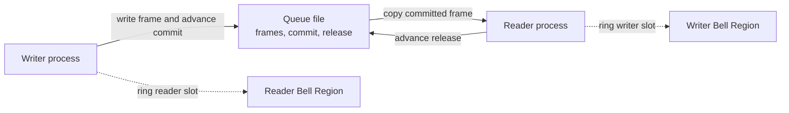

<!--
Licensed to the Apache Software Foundation (ASF) under one
or more contributor license agreements.  See the NOTICE file
distributed with this work for additional information
regarding copyright ownership.  The ASF licenses this file
to you under the Apache License, Version 2.0 (the
"License"); you may not use this file except in compliance
with the License.  You may obtain a copy of the License at

    https://www.apache.org/licenses/LICENSE-2.0

Unless required by applicable law or agreed to in writing,
software distributed under the License is distributed on an
"AS IS" BASIS, WITHOUT WARRANTIES OR CONDITIONS OF ANY
KIND, either express or implied.  See the License for the
specific language governing permissions and limitations
under the License.
-->

# IPC Contract for Plugin SDK Developers

Tenon is part of Apache BifroMQ (Incubating). See the [incubation disclaimer](../DISCLAIMER).

This document explains how to implement Tenon IPC in a new language. It defines the Queue v1 and Bell Region v1 File Formats, reading, writing, waiting, recovery, and the tests required for compatibility.

The [Plugin SDK contract](plugin-sdk-contract.md) covers startup, `Source` and `Sink` behavior, process metrics, and project scaffolding. Plugin authors using an existing SDK should start with the [plugin development guide](../guide/plugins.md#sdks-and-generators).

## Overview

Tenon passes records between two processes through a memory-mapped Queue file. Each Queue has exactly one writer and one reader at a time (SPSC).

A Bell Region is a second memory-mapped file used for notifications. A `Bell` only wakes a loop. After waking, the loop checks its `Queues` and local events again.



The Queue positions carry the real state:

- `commit` is the end of the bytes published by the writer. The reader checks it to find data.
- `release` is the end of the bytes returned by the reader. The writer checks it to find free space.
- A Bell wakes a waiting loop. It does not prove that data or space is available.

### Terms

| Term | Meaning |
| --- | --- |
| Queue | A bounded, non-overwriting, single-producer/single-consumer byte queue stored in a file. |
| Writer | The one live endpoint allowed to append to a Queue. |
| Reader | The one live endpoint allowed to read and release Queue records. |
| Logical position | A byte position that only moves forward. It does not return to zero when the file offset wraps. |
| Atomic operation | A read, write, or exchange that other processes cannot observe halfway through. |
| Bell Region | A file containing notification slots for waiting loops. |
| Bell slot | One 32-bit word owned by one waiting loop. Many peers may ring it. |
| Owned record | A record copied out of the mapping. It remains valid after release or mapping closure. |
| SDK layer | The code above IPC that handles business records, completion, and lifecycle. |

## Responsibilities

IPC owns file validation, mappings, frame planning, atomic positions, reader and writer operations, owned record bytes, and Bell wait and wake. It does not depend on Runner, Pipeline, SDK lifecycle, business Protobuf messages, Lua, or metrics. It does not interpret Source submission, Source completion, or Sink egress records.

The SDK layer creates and removes files, assigns one live writer and reader to each Queue, assigns one waiting loop to each Bell slot, encodes business records, decides completion, and manages shutdown and recovery.

A loop may serve several Queue endpoints. Many peers may ring the same slot. Queue and Bell files contain no ownership lock, reference count, or process-liveness state.

| Implementation | Consumers | Distribution |
| --- | --- | --- |
| [Rust `tenon-ipc`](rust/ipc/) | Runner and Rust Plugin SDK | Independently reusable crate, versioned with the SDK and included as a transitive dependency. |
| [Java `tenon-ipc`](java/ipc/) | Java Plugin SDK | Independently reusable Maven artifact, versioned with the SDK and included as a transitive dependency. |

## Queue v1 File Format

All integers are little-endian. In the tables, `u32` and `u64` mean unsigned 32-bit and 64-bit integers. Read fields at the listed byte offsets. Do not map the header to a language struct whose compiler may add padding.

The Queue has a fixed 192-byte header followed by the circular data region.


The diagram shows field order and ownership; it is not drawn to scale. Blue fields are immutable, green fields are written by the Queue writer, orange fields are written by the Queue reader, purple is the data region, and gray is padding. The table is the exact format.

| Byte range | Encoding and owner | Meaning |
| --- | --- | --- |
| `0..8` | immutable bytes | Magic `TENONQ\0\0` |
| `8..12` | immutable u32 | `formatVersion = 1` |
| `12..16` | zero padding | Must be zero |
| `16..24` | immutable u64 | Nonzero `maxPayloadSize`, the largest permitted frame body |
| `24..64` | zero padding | Must be zero |
| `64..72` | atomic u64, writer | `commit`, the exclusive end of published bytes |
| `72..76` | atomic u32, reader | `readerBellSlot`, the reader loop's slot number |
| `76..128` | zero padding | Must be zero |
| `128..136` | atomic u64, reader | `release`, the exclusive end of reusable bytes |
| `136..140` | atomic u32, writer | `writerBellSlot`, the writer loop's slot number |
| `140..192` | zero padding | Must be zero |

The Queue file contains a 192-byte header followed by the data region. The file length therefore determines the space available for frames:

```text
dataCapacity = fileLength - 192
```

For example, a 256-byte file has `256 - 192 = 64` bytes of data capacity. The capacity must be at least 16 bytes and a multiple of eight. Sixteen bytes is the smallest frame that can hold a nonempty body: eight bytes of frame header, at least one byte of body, and padding to eight bytes.

The complete file length, including the header, must be at most `2^63 - 1` bytes. This lets the supported platforms represent the length with their signed 64-bit file APIs. The capacity must also be a multiple of eight, so that exact maximum file length is not valid. A real system may have smaller storage or mapping limits.

### Calculating Frame Size

Each frame has an eight-byte header: four bytes for the body length and four reserved zero bytes. The body follows the header. The frame ends with zero padding so its total length is a multiple of eight. We call this rounding operation `align8`:

```text
align8(8)  = 8
align8(9)  = 16
align8(16) = 16
align8(17) = 24
```

For example, a 13-byte body needs an eight-byte header and three bytes of padding. Its frame takes `align8(8 + 13) = 24` bytes. The Queue header's `maxPayloadSize` limits the **body**, so the largest frame is:

```text
maximumFrameSize = align8(8 + maxPayloadSize)
```

This frame must fit in the data region. For example, a maximum body of 13 bytes needs at least 24 bytes of data capacity.

Queue v1 also limits a complete frame to the largest multiple of eight that fits in a signed 32-bit integer. This is a compatibility limit for all SDKs: the current Java IPC implementation copies a complete frame into a `byte[]`, whose length uses a Java `int`. Rust applies the same limit so it cannot create a Queue that Java rejects. A 64-bit JVM does not change the size of a Java `int` or a Java array's length.

```text
largest signed 32-bit integer        = 2,147,483,647
round down to a multiple of 8        = 2,147,483,640  (maximum frame)
subtract the 8-byte frame header      = 2,147,483,632  (maximum body)
```

For example, a body one byte larger would need `align8(8 + 2,147,483,633) = 2,147,483,648` bytes, which exceeds the frame limit. The maximum is a format limit; it does not guarantee that a runtime can allocate an array that large. A Queue may set a smaller `maxPayloadSize`, and IPC sets no additional business limit.

Implementations must check for integer overflow when adding the frame header and padding. Overflow means the result is larger than the integer type can represent. For example, a u64 cannot hold `u64::MAX + 8`. Reject such a size instead of allowing the calculation to wrap to a smaller number. Rust uses checked additions; another language may use an equivalent check. The protocol does not require a particular `align8` function.

`commit` and `release` are unsigned 64-bit logical byte positions. Each is a multiple of eight. They include wrap gaps and only move forward, even when the writer reaches the end of the data region and starts again at offset zero.

For example, with a 48-byte data region, logical position 56 refers to data offset `56 % 48 = 8`. Logical position 48 refers to data offset zero. The logical positions continue to increase; only the physical offset wraps.

```text
release <= commit
commit - release <= dataCapacity
```

A new Queue has `commit = release = 0`. Both Bell slot fields start at the unbound value `0xffffffff`. Opening validates but never resets or repairs a Queue. If a logical position would overflow u64, the Queue fails and its owner replaces it through normal recovery.

## Frames and Appends

A frame contains a four-byte unsigned body length, four zero bytes, the body, and zero padding to an eight-byte boundary.


An empty body is invalid. Body length zero is reserved for an eight-byte wrap marker. Validate body length, frame length, and position arithmetic before changing any Queue byte.

Given an aligned `frameLength`, plan an append as follows:

```text
used = commit - release
free = dataCapacity - used
offset = commit % dataCapacity
tail = dataCapacity - offset
wrap = tail < frameLength ? tail : 0
required = wrap + frameLength
```

- `used` is the space not yet released by the reader.
- `free` is the space the writer may use.
- `offset` is the physical offset in the data region.
- `tail` is the space from `offset` to the end of that region.
- `wrap` is the tail skipped when the frame does not fit there.
- `required` includes the frame and any wrap gap.

If `required > free`, return `Full` without changing bytes, positions, or Bell slots.

Otherwise:

1. If `wrap > 0`, write a wrap marker at `offset` and count the complete tail as used.
2. Write the frame at offset zero after a wrap, or at `offset` otherwise.
3. Finish the header, body, and zero padding.
4. Atomically write `commit + required` to `commit` using release ordering.
5. Notify the reader.

Writing `commit` makes the completed frame available to the reader. The reader must be able to see the complete frame when it sees the new `commit`. See [Sharing Data Between Processes](#sharing-data-between-processes) for the required ordering.

### Append Examples

With capacity 64, `release = 0`, `commit = 16`, and a 24-byte frame:

```text
used = 16, free = 48, offset = 16, tail = 48
wrap = 0, required = 24, new commit = 40
```

The frame is written at data offset 16.

With capacity 48, `release = commit = 32`, and a 24-byte frame:

```text
used = 0, free = 48, offset = 32, tail = 16
wrap = 16, required = 40, new commit = 72
```

The writer puts a wrap marker at offset 32, consumes the 16-byte tail, and writes the frame at offset zero. Only 8 bytes remain free. A second 24-byte frame cannot be added until space is released. A batch containing both frames needs `40 + 24 = 64` bytes and can never fit in this 48-byte Queue.

## Reading and Releasing

Reading and Releasing are separate. The reader may copy several records before processing finishes, but it releases only a completed contiguous prefix.

To read:

1. Atomically read `commit` using acquire ordering. This lets the reader see the frame bytes written before the writer published that position.
2. Return `Empty` without changing state when the local read position equals `commit`.
3. Read only the fixed frame header from the live mapping.
4. Skip the complete tail when the header is a wrap marker.
5. Prove that the complete frame is committed.
6. Copy the complete frame into owned memory once.
7. Validate the copy, then let the SDK layer decode it.

The local read position may be ahead of shared `release`, but never ahead of `commit`.

Only the reader advances `release`. To release, it finds the end of the largest contiguous completed prefix, atomically writes that position to `release` using release ordering, and notifies the writer. Before reusing space, the writer atomically reads `release` using acquire ordering. It never overwrites the unreleased range.


Owned records remain valid after release or mapping closure. A reopened reader starts at shared `release` and reads the unreleased prefix again, including records copied but not released by an earlier reader.

The SDK layer may plan several appends by applying the formula to each frame in order and carrying the planned `commit` forward. Count every header, padding byte, and wrap gap. If the group can never fit within `dataCapacity`, return an error instead of waiting. Otherwise wait for the complete required space before starting the group. The writer must not append other records between planning and waiting.

## Sharing Data Between Processes

The writer and reader access the same mapped memory at the same time. Atomic operations prevent a shared position or Bell slot from being read halfway through an update. They also need the right **memory ordering**: seeing a new position must make the earlier work associated with that position visible.

For example, the writer finishes a frame, then writes the new `commit` with release ordering. When the reader reads that value with acquire ordering, it can see the frame bytes written before the update. The same pairing applies when the reader finishes using space and updates `release`: the writer reads `release` before reusing that space. An acquire read may still see an older value; it does not promise the latest value immediately.

The terms *acquire* and *release* describe these ordering guarantees, not a required API or programming language. The word “release” in memory ordering is separate from the Queue field named `release`. A language may provide stronger operations that satisfy these requirements.

| Shared operation | Required ordering | Purpose |
| --- | --- | --- |
| Write `commit` or `release` | Release | Make earlier frame writes or reads complete before publishing the new position. |
| Read `commit` or `release` | Acquire | Observe the work associated with the position before reading or reusing its bytes. |
| Write an endpoint's Bell slot number | Release | Publish the slot binding before checking for work. |
| Read the peer's Bell slot number | Acquire | Read the published binding before ringing the peer. |
| Exchange a Bell slot to `0` to arm it | Acquire | Arm the slot before the waiting loop checks its conditions again. |
| Exchange a Bell slot to `1` to ring it | Release | Publish the notification after the Queue update. |

Binding and notification also require a **sequentially consistent fence** at the points listed below. A fence is an ordering operation; it does not read or write a Queue field. Both sides need these fences to coordinate binding with notification and avoid a missed wakeup. Use the language or platform's equivalent shared-memory operations, and test them across processes.

## Bell Region v1 File Format

All integers are little-endian. A Bell Region has a 64-byte header followed by one 64-byte slot per waiting loop.


The diagram is not drawn to scale. The table is exact.

| Byte range | Encoding | Meaning |
| --- | --- | --- |
| `0..8` | bytes | Magic `TENONBEL` |
| `8..12` | u32 | `formatVersion = 1` |
| `12..16` | u32 | Nonzero `slotCount` |
| `16..24` | u64 | Diagnostic `epoch`; every bit pattern is valid |
| `24..64` | zero padding | Must be zero |
| `i × 64 + [64, 68)` | aligned atomic u32 | Slot `i`: `0 = armed`, `1 = notified` |
| remaining 60 bytes of each slot | zero padding | Must be zero |

`[64, 68)` includes byte 64 and excludes byte 68. For example, slot 0 uses bytes `[64, 68)`, slot 1 uses `[128, 132)`, and slot 2 uses `[192, 196)`. The 60 bytes after each slot value are padding.

The exact file length is `align4096(64 + slotCount * 64)`. This alignment is part of the format, independent of host page size. Creation sets every slot to `1` and zeroes all padding, including final alignment bytes. Opening validates the header, exact length, slot values, and padding. The final alignment area carries no state.

Queue and Bell versions are validated independently, and unknown versions are rejected. Changing a field's meaning requires a new format version and an explicit upgrade plan. An implementation must not reinterpret a v1 file silently.

Pipeline increments `epoch`, with saturation, when replacing a Region. Reaching u64 maximum does not prevent recovery. The epoch is diagnostic only. It does not choose an owner, validate binding, prove completion, control replay, or reset Queue positions.

## Binding and Waiting

Each endpoint knows its own loop's Bell Region and the peer's Region. A slot number has meaning only within its Region. Processes may map the same file at different virtual addresses, but native wait and wake must address the same shared backing word.

To bind an endpoint:

1. Open and validate the Queue and both Regions.
2. Atomically write its own slot number into `readerBellSlot` or `writerBellSlot` using release ordering.
3. Execute a sequentially consistent fence before the first arm and condition check.

If a notifier sees the unbound value `0xffffffff`, it skips notification. The binding endpoint's later check must see already-published Queue progress. Any other out-of-range slot is an error.

### Waiting Without Losing a Notification

A waiting loop checks every Queue and local event assigned to its slot:

1. Check all conditions. Handle ready work without sleeping.
2. Atomically replace the slot value with `0` using acquire ordering. This arms it.
3. Check the same conditions again.
4. If work is ready, continue without sleeping.
5. Otherwise, wait while the slot still equals `0`.
6. After a wake, changed value, spurious wake, or interruption, return to step 1.

A publisher:

1. Publishes real state by advancing `commit` or `release`.
2. Executes a sequentially consistent fence.
3. Atomically reads the peer's slot number from the Queue header using acquire ordering.
4. Atomically replaces that Bell slot's value with `1` using release ordering and obtains its previous value.
5. Calls native wake only when the old value was `0`. An old value of `1` means a notification is already pending.

The second condition check prevents this lost wakeup:

```text
loop checks Queue: no work
publisher advances commit and rings while the slot is 1
loop arms the slot by changing it to 0
```

Without another check after arming, the loop could sleep while data is ready. Repeated rings may merge because every wake causes a complete condition check.

Use the same steps when waiting for free space, using `release` and the writer's slot.

A local shutdown or timer event must remain pending for the next check or wake an already waiting loop. Publish the event before interrupting. `Interrupted` and OS `EINTR` do not mean data, space, closure, or failure; they make the owner check again. The interrupter adds no shared Queue state and is not a Plugin business API. Do not hold a registration lock during record copying or a blocking wait. Do not replace this protocol with periodic polling or a fixed timeout. A real timer deadline may be one of the checked conditions.

Repeated local interrupts may merge, but at least one interrupt must remain observable until the waiting loop checks its local events.

Attempts and waits remain separate:

```text
try append -> Full -> wait for exact required space -> retry
try read   -> Empty -> wait for data                -> retry
```

Waiting does not copy, commit, or release. A writer uses the current record's exact size, including its possible wrap gap. Waiting for a receipt uses the same writer slot as waiting for space.

## Platform Operations

Supported targets are Linux amd64/arm64 and macOS amd64/arm64. macOS requires version 14.4 or newer.

Linux uses shared futex wait and wake, never process-private variants. macOS uses `os_sync_wait_on_address` and `os_sync_wake_by_address_any` with matching `SHARED` flags.

Both processes use process-shared wait and wake on the same backing word. Preserve native errors. `EINTR`, a changed slot value, and a spurious wake return to the condition loop instead of failing the Queue. For another platform, document supported OS/CPU pairs and add native cross-process tests for waits, wakes, interruption, changed values, notification without a waiter, and fatal errors.

## Errors, Closure, and Recovery

Format error codes are stable across languages. Exception types and messages are language-specific.

| Code suffix after `ipc.queue.` | Rejected condition |
| --- | --- |
| `header_too_short` | Fewer than 192 header bytes |
| `magic_invalid`, <br/>`format_version_unsupported` | Wrong magic or unsupported version |
| `capacity_invalid`, <br/>`max_payload_size_invalid` | Invalid capacity or unrepresentable or unsupported frame size |
| `header_padding_nonzero` | Nonzero reserved header bytes |
| `position_unaligned`, <br/>`release_ahead_of_commit`, <br/>`occupancy_exceeds_capacity` | Invalid shared positions |
| `position_exhausted` | Logical position cannot advance without overflow |
| `record_empty`, <br/>`record_too_large` | Invalid record body length |
| `frame_destination_too_small`, <br/>`frame_truncated` | Insufficient frame output space or incomplete frame bytes |
| `frame_header_padding_nonzero`, <br/>`frame_padding_nonzero` | Nonzero frame padding |

| Code suffix after `ipc.bell.` | Rejected condition |
| --- | --- |
| `region_too_short` | Fewer than 64 header bytes |
| `magic_invalid`, <br/>`format_version_unsupported` | Wrong magic or unsupported version |
| `slot_count_invalid` | Zero slot count or unrepresentable creation length |
| `region_length_invalid` | File length disagrees with slot count |
| `padding_nonzero` | Nonzero header or slot padding |
| `slot_state_invalid` | Slot word other than zero or one |
| `slot_out_of_range` | Binding or notification addresses an absent slot |

Opening failures do not repair files or leave partial endpoints. Runtime corruption and native wait/wake failures stop the current use and reach the lifecycle owner. Preserve native I/O causes. Do not skip corrupt records.

A notification may fail after `commit` or `release` was published. The operation already happened, so do not repeat the same write or release. If a blocked worker cannot be proven stopped, recover at the process boundary. Never unmap memory that it may still access.

Normal closure publishes stopping state, interrupts waits, joins workers, and then releases mappings. Do not replace a Region while a waiter or notifier may use it. Reap an old endpoint before binding its replacement.

Uncommitted bytes remain invisible after writer failure. Committed but unreleased records remain replayable after reader failure. This is not a durable log and does not promise replay after Pipeline or machine failure.

Metrics belong to the SDK layer. An observer may hold a weak mapping reference and take bounded atomic snapshots. It must not create another endpoint, read records, extend mapping lifetime, or invent a sample when concurrent progress prevents a consistent one.

## Build and Acceptance

Use the pinned Rust toolchain, Cargo lockfiles, and [Java toolchain properties](java/.mvn/tenon-toolchain.properties). The Maven wrapper selects the pinned JDK and Maven. Run from the repository root:

```sh
cargo test -p tenon-ipc --all-targets --features repository-test-support --locked -- --test-threads=1
sdk/java/mvnw --batch-mode --file sdk/java/ipc/pom.xml verify
tools/verify-rust.sh
python3 tools/verify-ipc-fuzz.py
```

Use the shared [Queue vectors](../contracts/ipc/test-fixtures/queue_v1_test_vectors.json) and [Bell vectors](../contracts/ipc/test-fixtures/bell_v1_test_vectors.json) directly. Packaging may copy them into an archive, but do not maintain another editable copy. Keep Rust `repository-test-support` exports and Java internal test fixtures out of ordinary SDK distributions.

The first two commands test the Rust and Java IPC modules. `tools/verify-rust.sh` also runs cross-language and Runner/SDK integration checks. See the [fuzzing guide](../fuzz/README.md) for the required fuzzing toolchain.

| Required proof | Executable evidence |
| --- | --- |
| Layout, append, wrap, corrupt input, stable errors | Shared vectors; Rust [format tests](rust/ipc/tests/format_contract.rs); Java [contract tests](java/ipc/src/test/java/org/apache/bifromq/tenon/sdk/ipc/) |
| FIFO, `Full`/`Empty` without mutation, owned copies, prefix release, reopen, interruption | Rust [runtime tests](rust/ipc/tests/runtime_contract.rs), [reader batch tests](rust/ipc/tests/reader_batches.rs), Java runtime tests |
| Publish before arm, before sleep, after sleep; interruption, closure, notification failure | Rust Bell models and native wait/wake tests |
| Writer and reader crashes at each publication step | Real mappings and child-process `SIGKILL` [tests](rust/ipc/src/queue/mapped/tests/crash.rs) |
| Rust/Java bidirectional queues, lifecycle, recovery | [Runner Java tests](../tests/runner_java_archetype.rs), Java SDK lifecycle tests, Rust SDK process tests |
| Arbitrary bytes and bounded operation sequences | [Fuzz targets](../fuzz/) and the shared Queue model |

Test packaged artifacts as well as source builds. Generate the Rust IPC and SDK archives and build projects from their extracted contents. For Java, use an isolated Maven repository containing IPC, process metrics, the Plugin SDK, Maven Plugin, and Archetype.

Run applicable tests on every platform in the [CI matrix](../.github/workflows/ci.yml) and record the revision and platform. For performance changes, measure throughput, latency, CPU, and memory at equal acknowledgement boundaries, including an independently stalled channel. Keep performance benchmarks out of ordinary correctness runs.

## Adding Another Language

1. Create `sdk/<language>/ipc`.
2. Pass the shared Queue and Bell vectors.
3. Test corruption, crashes, and native cross-process wait/wake.
4. Prove bidirectional interoperability with an existing language.
5. Implement lifecycle and Source/Sink adapters in `sdk/<language>/plugin-sdk` using the [Plugin SDK contract](plugin-sdk-contract.md).
6. Add Source, Sink, and Source-and-Sink scaffolds.
7. Build installable bundles and test real Runner data flow and failures.
8. Pass acceptance on every declared platform before announcing official support.
